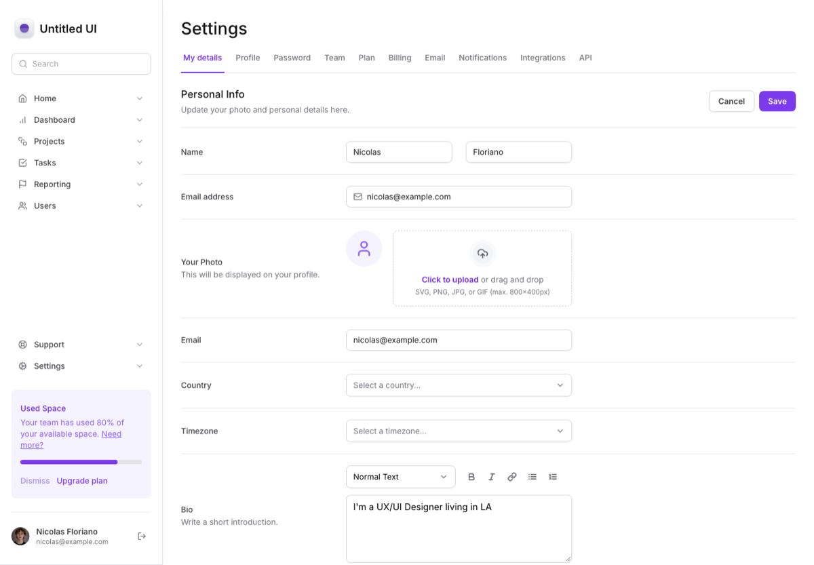
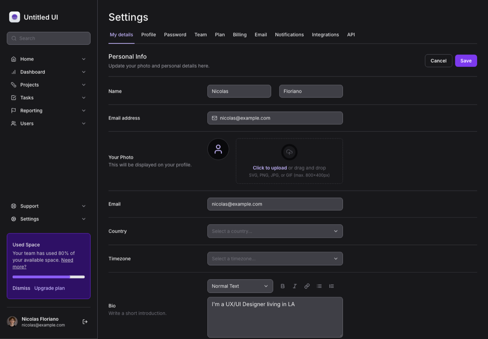

# dashboard-tailwind

A settings page built with Next.js 14, TypeScript and Tailwind CSS, with a light and a dark theme. It is a 2024 learning project, and I kept it because the component structure is the part I'm happy with.

| Light | Dark |
| --- | --- |
|  |  |

## What's in it

- **Compound components.** `Input.Root` / `Input.Control`, and `FileInput.Root` / `Trigger` / `Control` / `FileList` / `FileItem` / `ImagePreview`, share state through context instead of long prop lists.
- **Radix primitives** for the select and the tabs, styled with Tailwind and `tailwind-variants`.
- **Responsive layout.** A custom grid template for the form rows that collapses to a single column on small screens, a scrollable tab bar, and a sidebar that becomes a collapsible menu on mobile.
- **Dark mode** through Tailwind's `dark:` variants.
- **Small motion details.** A slide-and-fade on the select menu and auto-animated file lists.

## Run it

```bash
yarn install
yarn dev
```

Then open http://localhost:3000. `yarn build` and `yarn lint` both pass.

## Stack

Next.js 14 (App Router), React 18, TypeScript, Tailwind CSS 3, Radix UI, auto-animate, Lucide icons.

## Credit

A learning project. The layout follows the Untitled UI settings page, so the design is not mine, and the ESLint config is Rocketseat's.
